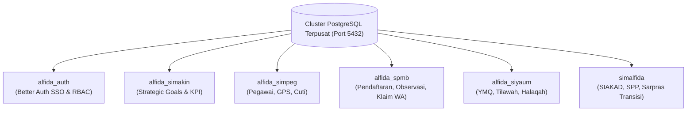
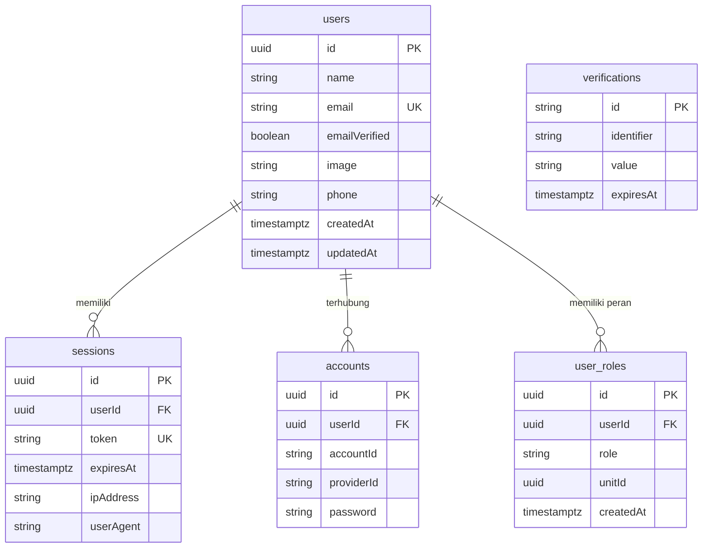
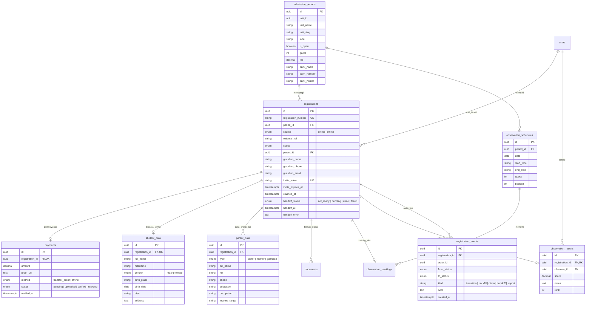
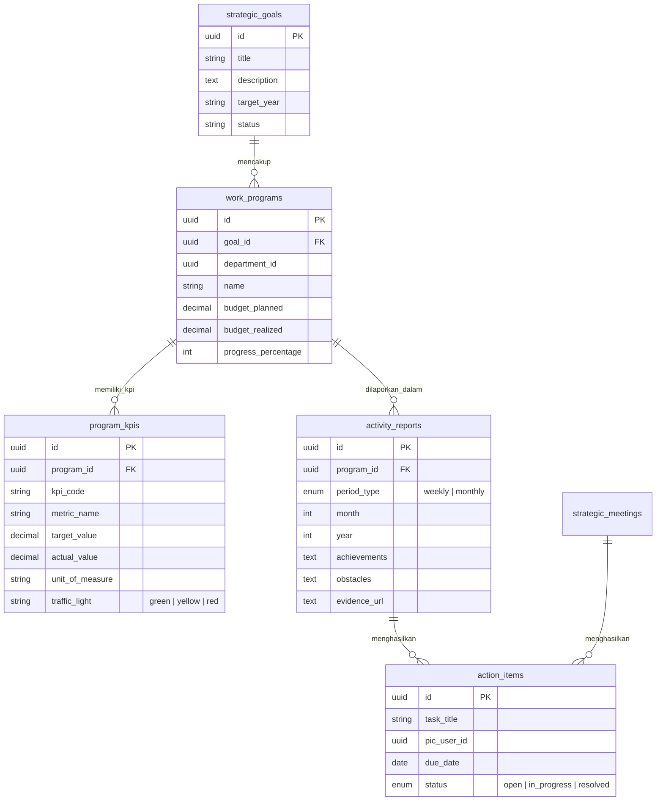
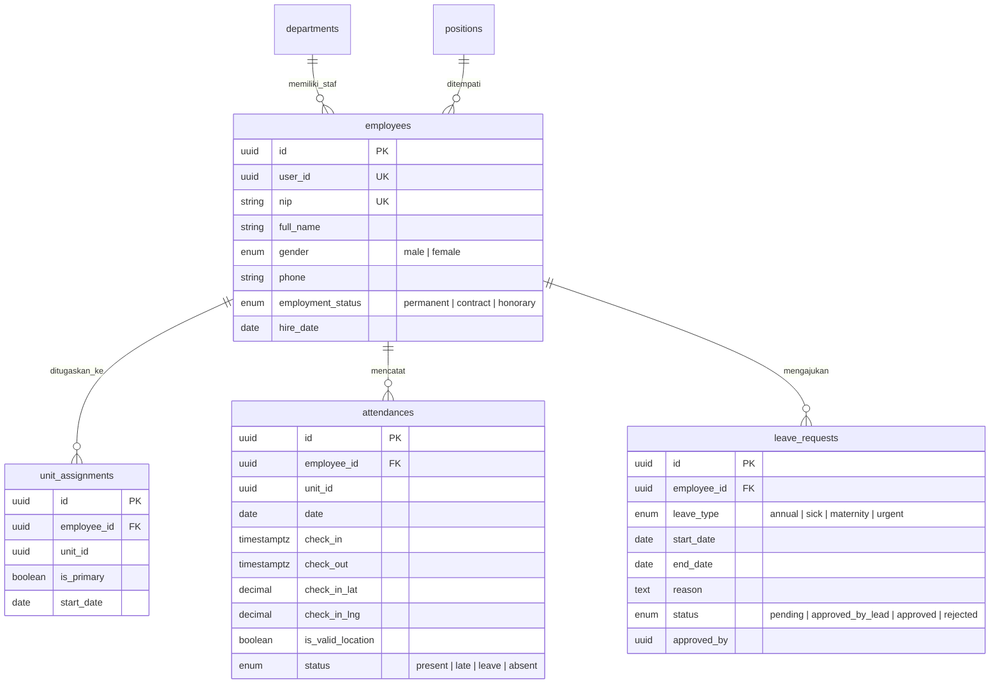
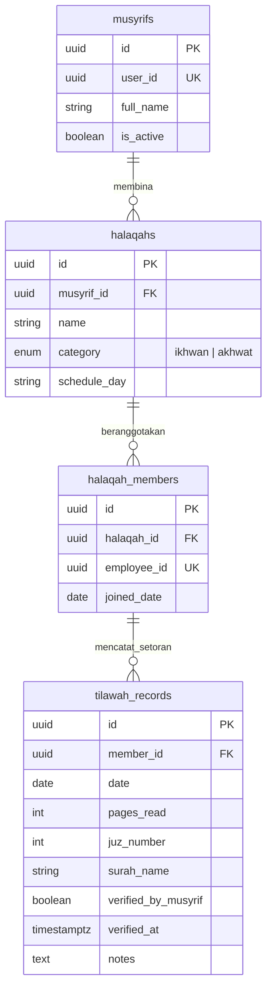

# Skema Database (DB Schema)

## SIM-Alfida: Sistem Informasi Manajemen Terpadu Yayasan Alfida

| Atribut         | Detail                                                                 |
| --------------- | ---------------------------------------------------------------------- |
| **Versi**       | 1.0.0-microservices                                                    |
| **Tanggal**     | 13 Oktober 2026                                                        |
| **Engine**      | PostgreSQL 16 Terpusat (Coolify VPS)                                   |
| **ORM**         | Prisma 6 (Multi-output isolated client per service)                    |
| **Referensi**   | PRD.md, TDD.md, coolify-microservices.md                               |

---

## 1. Arsitektur Multi-Database Terpusat

Untuk menjaga independensi siklus hidup data sekaligus memaksimalkan efisiensi memori VPS Coolify (8 GB RAM), SIM-Alfida mengadopsi **satu cluster database PostgreSQL terpusat** dengan **database logis terpisah per domain microservice**.

---

## 2. Skema Database per Layanan

### 2.1 Database Service Auth (`alfida_auth`)

Database ini menjadi sumber identitas tunggal bagi seluruh pemangku kepentingan yayasan (guru, karyawan, pimpinan, pengurus, orang tua santri).

#### Diagram ERD (Auth)

---

### 2.2 Database Service SPMB (`alfida_spmb`)

Database khusus penerimaan peserta didik baru yang mencakup jalur pendaftaran online mandiri, entri offline panitia di sekolah, impor batch CSV, undangan klaim WhatsApp, serta seleksi observasi.

#### Diagram ERD (SPMB)

---

### 2.3 Database Service SIMAKIN (`alfida_simakin`)

Database khusus manajemen kinerja strategis, program kerja yayasan, monitoring KPI, pelaporan berkala, dan penanganan isu.

#### Diagram ERD (SIMAKIN)

---

### 2.4 Database Service SIMPEG (`alfida_simpeg`)

Database pengelolaan sumber daya manusia, penugasan unit, presensi kehadiran berbasis GPS browser riil, dan permohonan cuti.

#### Diagram ERD (SIMPEG)

---

### 2.5 Database Service SIYAUM (`alfida_siyaum`)

Database monitoring Yaum Ma'al Quran (YMQ) bagi seluruh tenaga pendidik dan kependidikan di bawah bimbingan musyrif halaqah.

#### Diagram ERD (SIYAUM)

---

### 2.6 Database Monolit Legacy (`simalfida`)

Database utama yang menampung modul dalam masa transisi:
- **Akademik**: `academic_years`, `classes`, `subjects`, `teacher_assignments`, `grades`, `lesson_plans`, `student_enrollments`, `lhbs_reports`.
- **Keuangan SPP**: `spp_bills`, `spp_payments`, `bank_accounts`.
- **Sarpras**: `inventory_items`, `inventory_categories`, `room_bookings`.
- **Kesekretariatan**: `guestbook_entries`, `correspondences`.
- **Tabel Penampung Handoff**: `registrations`, `student_data`, `parent_data` yang di-upsert oleh SPMB API via `POST /api/internal/spmb-handoff`.

---

## 3. Konvensi Rekayasa Data

| Aspek | Standar yang Diterapkan |
|---|---|
| **Penamaan Tabel** | `snake_case` bentuk jamak (contoh: `admission_periods`, `leave_requests`). |
| **Penamaan Kolom** | `snake_case` (contoh: `registration_number`, `is_valid_location`). |
| **Kunci Utama (PK)** | UUID v4 / v7 dengan nama kolom `id`. |
| **Kunci Asing (FK)** | Format `{referenced_table_singular}_id` (contoh: `period_id`, `employee_id`). |
| **Waktu / Timestamps**| `created_at` (NOT NULL DEFAULT now() timestamptz), `updated_at` (nullable timestamptz). |
| **Mata Uang / Nilai** | `Decimal(12, 2)` untuk uang (biaya SPP, anggaran), `Decimal(5, 2)` untuk nilai/skor ujian. |
| **Enums** | Native PostgreSQL enum untuk integritas data di tingkat basis data. |
