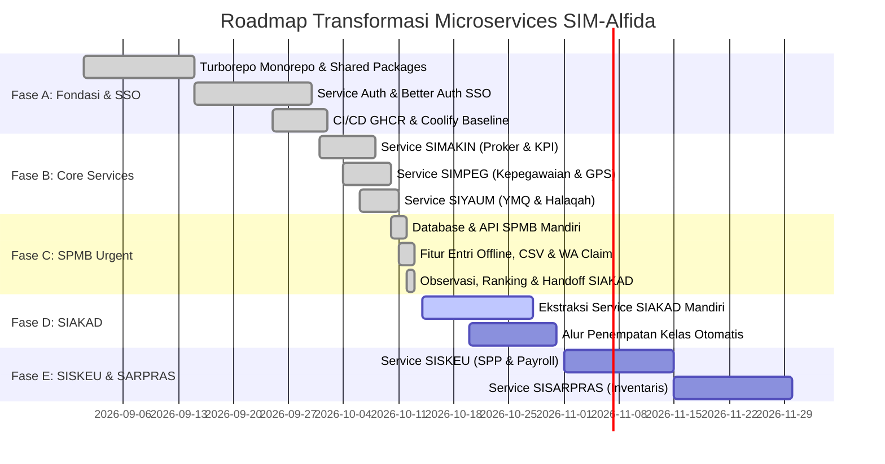

# Sprint Plan & Roadmap

## Transformasi Microservices SIM-Alfida (Tahun 2026)

| Atribut         | Detail                                                                 |
| --------------- | ---------------------------------------------------------------------- |
| **Versi**       | 2.0.0-microservices                                                    |
| **Tanggal**     | 13 Oktober 2026                                                        |
| **Metodologi**  | Agile Kanban / Scrum (2 minggu per iterasi)                            |
| **Target Infra**| Coolify VPS (2 vCPU, 8 GB RAM, 100 GB Storage)                         |
| **Referensi**   | PRD.md, TDD.md, coolify-microservices.md                               |

---

## 1. Ikhtisar Roadmap Transformasi

Untuk mengatasi kepadatan beban monolit lama dan mengakomodasi kebutuhan spesifik setiap bidang di Yayasan Alfida, roadmap dibagi ke dalam lima fase transformasi strategis:

---

## 2. Status & Rincian Sprint per Fase

### Fase A: Fondasi Microservices & Single Sign-On (SELESAI)

| Sprint / Task | Cakupan Pekerjaan | Status | Artefak / Hasil |
|---|---|---|---|
| **SPRINT-M01** | Setup Turborepo monorepo multi-service, konfigurasi pnpm workspaces, dan pipeline caching build | Selesai | `turbo.json`, `pnpm-workspace.yaml` |
| **SPRINT-M02** | Pembangunan shared packages `@alfida/contracts` (DTO bersama), `@alfida/auth-sdk` (guard JWT terdistribusi), dan `@alfida/ui` (komponen UI terpadu) | Selesai | `packages/contracts`, `packages/auth-sdk`, `packages/ui` |
| **SPRINT-M03** | Pembangunan Service Auth (`auth.alfida.or.id`) menggunakan Better Auth terpusat dengan cookie session domain `.alfida.or.id` | Selesai | `services/auth` (Web + API) |
| **SPRINT-M04** | Setup otomatisasi CI/CD GitHub Actions multi-stage build menuju GitHub Container Registry (GHCR) | Selesai | `.github/workflows/deploy-services.yml` |

---

### Fase B: Core Operational Services (SELESAI)

| Sprint / Task | Cakupan Pekerjaan | Status | Artefak / Hasil |
|---|---|---|---|
| **SPRINT-M05** | **Service SIMAKIN (`simakin.alfida.or.id`)**: Perencanaan program kerja biro/bidang, monitoring 113 indikator KPI yayasan, laporan bulanan/mingguan, tindak lanjut rapat, dan dashboard eksekutif BPH | Selesai | `services/simakin` (Web + API) |
| **SPRINT-M06** | **Service SIMPEG (`simpeg.alfida.or.id`)**: Master biodata pegawai, penugasan unit kerja, presensi kehadiran berbasis geolokasi GPS browser riil, manajemen hari libur, pengajuan & persetujuan cuti berjenjang | Selesai | `services/simpeg` (Web + API) |
| **SPRINT-M07** | **Service SIYAUM (`siyaum.alfida.or.id`)**: Monitoring Yaum Ma'al Quran (YMQ) guru & karyawan, pengelompokan halaqah, pencatatan tilawah harian, dan verifikasi setoran berotorisasi musyrif | Selesai (Siap Uji) | `services/siyaum` (Web + API) |

---

### Fase C: Penerimaan Santri Baru / SPMB Musim Berjalan (SELESAI)

| Sprint / Task | Cakupan Pekerjaan | Status | Artefak / Hasil |
|---|---|---|---|
| **SPRINT-M08** | **Database & Model SPMB Mandiri**: Skema terisolasi `alfida_spmb` mencakup periode penerimaan, registrasi online/offline, data siswa, orang tua, pembayaran, dokumen, jadwal observasi, dan riwayat audit `registration_events` | Selesai | `services/spmb/api/prisma/schema.prisma` |
| **SPRINT-M09** | **Akomodasi Pendaftar Luring & Integrasi WA**: Form entri manual bagi panitia unit (offline walk-in), opsi *backfill* langsung lunas dan bernilai, impor massal CSV dengan validasi preview, generator link klaim unik dan tombol WhatsApp resmi (`wa.me`) | Selesai | `services/spmb/api/src/imports`, `services/spmb/api/src/invites`, `services/spmb/web/src/app/admin` |
| **SPRINT-M10** | **Seleksi Observasi & Handoff SIAKAD**: Penjadwalan kuota sesi observasi, input skor penguji, perankingan otomatis, penetapan kelulusan diterima/ditolak, serta endpoint handoff terproteksi secret key ke SIAKAD legacy (`POST /api/internal/spmb-handoff`) | Selesai | `services/spmb/api/src/observations`, `services/spmb/api/src/handoff`, `apps/api/src/internal` |

---

### Fase D: Pemisahan SIAKAD & Penempatan Kelas (BERIKUTNYA)

| Sprint / Task | Cakupan Pekerjaan | Status | Target Waktu |
|---|---|---|---|
| **SPRINT-M11** | Ekstraksi modul akademik dari monolit ke service `siakad.alfida.or.id` mandiri (Next.js + NestJS + DB `alfida_siakad`) | Direncanakan | Sprint Depan |
| **SPRINT-M12** | Antarmuka penempatan rombongan belajar (kelas paralel) otomatis untuk siswa berstatus diterima (*accepted*) dari SPMB | Direncanakan | Sprint Depan |
| **SPRINT-M13** | Modul pembelajaran guru: jurnal mengajar harian, Prota, Promes, RPP, input nilai asesmen, dan generator rapor LHBS | Direncanakan | Sprint Depan |

---

### Fase E: SISKEU & SISARPRAS (BERIKUTNYA)

| Sprint / Task | Cakupan Pekerjaan | Status | Target Waktu |
|---|---|---|---|
| **SPRINT-M14** | Pemisahan modul SPP dan Approval Penggajian ke `siskeu.alfida.or.id` (DB `alfida_siskeu`) | Direncanakan | Q4 2026 |
| **SPRINT-M15** | Integrasi pembayaran virtual account / payment gateway dan pembukuan kas yayasan | Direncanakan | Q4 2026 |
| **SPRINT-M16** | Pemisahan modul inventaris dan peminjaman fasilitas ke `sisarpras.alfida.or.id` (DB `alfida_sisarpras`) | Direncanakan | Q4 2026 |

---

## 3. Prioritas Mendesak (Fokus 3 Hari ke Depan)

1. **Uji Fungsional SIMAKIN & SIMPEG**:
   - Memastikan panitia dan kepala biro dapat login via SSO `auth.alfida.or.id` dan menyusun target proker di `simakin.alfida.or.id`.
   - Menguji presensi masuk/pulang guru di `simpeg.alfida.or.id` menggunakan peramban ponsel (GPS riil) pada radius sekolah.
2. **Operasional SPMB Unit**:
   - Panitia unit mengentri data pendaftar offline yang sudah mendaftar via formulir kertas/WhatsApp ke `spmb.alfida.or.id/admin`.
   - Panitia membagikan tautan klaim akun via tombol WhatsApp (`wa.me`) kepada orang tua santri.
   - Menguji alur penetapan kelulusan (*accept*) dan sinkronisasi data ke SIAKAD monolit.
3. **Pengujian Internal SIYAUM**:
   - Musyrif menguji verifikasi setoran tilawah anggota halaqah masing-masing.

---

## 4. Kriteria Penyelesaian (Definition of Done)

Setiap inisiatif microservice dianggap selesai bila memenuhi standar:
- [x] Kode ditulis dengan TypeScript murni tanpa tipe `any`.
- [x] Lulus verifikasi lint dan typecheck (`pnpm turbo run typecheck`).
- [x] Lulus proses build container standalone (`pnpm turbo run build`).
- [x] Menggunakan komponen antarmuka resmi dari `@alfida/ui` dengan dukungan empty/loading/error state.
- [x] Terlindungi guard otentikasi JWT SSO (`@alfida/auth-sdk`).
- [x] Terdaftar pada pipeline deployment GitHub Actions GHCR dan dokumentasi Coolify.
