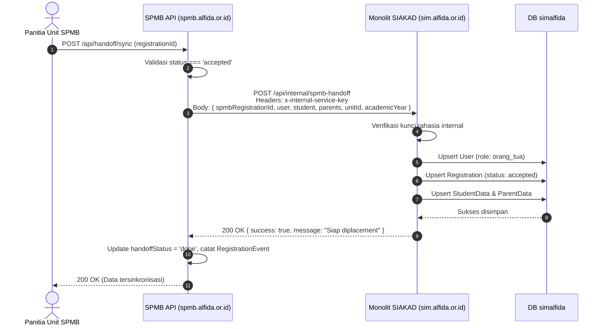

# Technical Design Document (TDD)

## SIM-Alfida: Sistem Informasi Manajemen Terpadu Yayasan Alfida

| Atribut         | Detail                                                                 |
| --------------- | ---------------------------------------------------------------------- |
| **Versi**       | 1.0.0-microservices                                                    |
| **Tanggal**     | 13 Oktober 2026                                                        |
| **Penulis**     | Tim Pengembangan SIM-Alfida                                            |
| **Status**      | Implemented & Active Deployment                                        |
| **Arsitektur**  | Monorepo Microservices (Turborepo + Next.js + NestJS + Prisma)         |
| **Referensi**   | PRD.md, DB-SCHEMA.md, coolify-microservices.md, AGENTS.md               |

---

## 1. Arsitektur Sistem

SIM-Alfida mengadopsi pendekatan **Monorepo Microservices**. Seluruh kode sumber disimpan dalam satu repositori yang dikelola oleh **Turborepo** dan **pnpm workspaces**, dengan pemisahan tegas antara layanan mandiri (*services*), paket bersama (*shared packages*), dan aplikasi monolit legacy (*apps*) yang berada dalam masa transisi.

### 1.1 Diagram Arsitektur Ekosistem

```mermaid
graph TB
    subgraph Browser["Peramban Klien (Domain: *.alfida.or.id)"]
        UserBrowser["Pengguna (Browser)"]
    end

    subgraph ReverseProxy["Traefik / Coolify Reverse Proxy (SSL *.alfida.or.id)"]
        Router["Router & SSL Termination"]
    end

    subgraph ServiceAuth["Container 1: Auth Service (auth.alfida.or.id)"]
        AuthWeb["Next.js Web (Port 3000)"]
        AuthAPI["NestJS API (Port 3001)"]
        BetterAuthCore["Better Auth Engine"]
    end

    subgraph ServiceSimakin["Container 2: SIMAKIN (simakin.alfida.or.id)"]
        SimakinWeb["Next.js Web (Port 3000)"]
        SimakinAPI["NestJS API (Port 3001)"]
    end

    subgraph ServiceSimpeg["Container 3: SIMPEG (simpeg.alfida.or.id)"]
        SimpegWeb["Next.js Web (Port 3000)"]
        SimpegAPI["NestJS API (Port 3001)"]
    end

    subgraph ServiceSpmb["Container 4: SPMB (spmb.alfida.or.id)"]
        SpmbWeb["Next.js Web (Port 3000)"]
        SpmbAPI["NestJS API (Port 3001)"]
    end

    subgraph ServiceSiyaum["Container 5: SIYAUM (siyaum.alfida.or.id)"]
        SiyaumWeb["Next.js Web (Port 3000)"]
        SiyaumAPI["NestJS API (Port 3001)"]
    end

    subgraph MonolithLegacy["Container 6: Monolit Legacy (sim.alfida.or.id)"]
        LegacyWeb["Next.js Web (Port 3000)"]
        LegacyAPI["NestJS API (Port 3001)"]
        InternalEndpoint["Internal Handoff Endpoint"]
    end

    subgraph SharedPackages["Shared Packages (@alfida/*)"]
        PkgContracts["@alfida/contracts"]
        PkgAuthSDK["@alfida/auth-sdk"]
        PkgUI["@alfida/ui"]
    end

    subgraph DatabaseCluster["PostgreSQL Terpusat (Coolify VPS)"]
        DBAuth[("alfida_auth")]
        DBSimakin[("alfida_simakin")]
        DBSimpeg[("alfida_simpeg")]
        DBSpmb[("alfida_spmb")]
        DBSiyaum[("alfida_siyaum")]
        DBLegacy[("simalfida")]
    end

    UserBrowser --> Router
    Router -->|auth.alfida.or.id| AuthWeb
    Router -->|simakin.alfida.or.id| SimakinWeb
    Router -->|simpeg.alfida.or.id| SimpegWeb
    Router -->|spmb.alfida.or.id| SpmbWeb
    Router -->|siyaum.alfida.or.id| SiyaumWeb
    Router -->|sim.alfida.or.id| LegacyWeb

    AuthWeb --> AuthAPI
    AuthAPI --> BetterAuthCore
    BetterAuthCore --> DBAuth

    SimakinWeb --> SimakinAPI
    SimakinAPI --> DBSimakin

    SimpegWeb --> SimpegAPI
    SimpegAPI --> DBSimpeg

    SpmbWeb --> SpmbAPI
    SpmbAPI --> DBSpmb

    SiyaumWeb --> SiyaumAPI
    SiyaumAPI --> DBSiyaum

    LegacyWeb --> LegacyAPI
    LegacyAPI --> DBLegacy

    SpmbAPI -.->|Handoff HTTP (x-internal-service-key)| InternalEndpoint
    InternalEndpoint --> DBLegacy

    PkgContracts -.-> SimakinAPI & SimpegAPI & SpmbAPI & SiyaumAPI
    PkgAuthSDK -.-> SimakinAPI & SimpegAPI & SpmbAPI & SiyaumAPI
    PkgUI -.-> SimakinWeb & SimpegWeb & SpmbWeb & SiyaumWeb
```

---

## 2. Pola Kontainer & Efisiensi Memori Server

### 2.1 Alasan Pola 1 Container Gabungan per Service
Spesifikasi VPS produksi di Coolify adalah **2 vCPU, 8 GB RAM, dan 100 GB SSD**. Jika setiap frontend dan backend dipisah menjadi kontainer Docker mandiri, maka dibutuhkan lebih dari 12 kontainer aktif yang berisiko menyebabkan *Out-of-Memory (OOM)* pada server.

Oleh karena itu, diterapkan pola **1 Container Gabungan per Microservice**:
- **Next.js Web (Frontend)** dijalankan dalam mode `standalone` pada port `3000`.
- **NestJS API (Backend)** dijalankan sebagai proses Node.js pada port `3001`.
- Kedua proses dikelola oleh skrip `start.sh` di dalam satu kontainer Docker berbasis `node:22-alpine`.
- Next.js melakukan *internal proxy rewrite* untuk panggilan `/api/*` langsung ke `http://127.0.0.1:3001/api/*` tanpa keluar kontainer.
- Hasil pengujian: Total konsumsi RAM hanya berkisar antara **180 MB hingga 320 MB per kontainer service**, sehingga total memori untuk 5 service aktif hanya memakan sekitar 1.5 GB RAM.

### 2.2 Template Dockerfile & Start Script
Contoh struktur yang diterapkan pada `services/*/Dockerfile`:

```dockerfile
FROM node:22-alpine AS base
RUN apk add --no-cache libc6-compat \
  && corepack enable pnpm \
  && corepack prepare pnpm@12.6.0 --activate
ENV NEXT_TELEMETRY_DISABLED=1 \
    TURBO_TELEMETRY_DISABLED=1

FROM base AS builder
WORKDIR /app
COPY . .
RUN pnpm install --frozen-lockfile
RUN pnpm --filter @alfida/<service>-api exec prisma generate
RUN pnpm --filter @alfida/contracts build
RUN pnpm --filter @alfida/auth-sdk build
RUN pnpm --filter @alfida/ui build
RUN pnpm --filter @alfida/<service>-api build
RUN pnpm --filter @alfida/<service>-web build

FROM base AS runner
WORKDIR /app
ENV NODE_ENV=production
RUN addgroup --system --gid 1001 nodejs && adduser --system --uid 1001 appuser
COPY --from=builder /app ./
RUN chmod +x services/<service>/start.sh
USER appuser
EXPOSE 3000
CMD ["./services/<service>/start.sh"]
```

Dan berkas `start.sh`:
```bash
#!/bin/sh
set -e
echo "Memulai Backend API (NestJS) pada port 3001..."
PORT=3001 node services/<service>/api/dist/main.js &

echo "Memulai Frontend Web (Next.js) pada port 3000..."
PORT=3000 node services/<service>/web/.next/standalone/services/<service>/web/server.js
```

---

## 3. Struktur Direktori Repositori

```
simalfida/
├── .github/
│   └── workflows/
│       └── deploy-services.yml       # CI/CD otomatisasi build & push GHCR
├── docs/                             # Dokumentasi resmi arsitektur & panduan
├── packages/                         # Shared Packages
│   ├── contracts/                    # Zod schemas, DTOs, dan enums bersama
│   ├── auth-sdk/                     # Guard otorisasi JWT SSO & session extractor
│   ├── ui/                           # Komponen UI design system Yayasan Alfida
│   ├── database/                     # Skema Prisma monolit legacy (@sim/database)
│   └── shared/                       # Tipe TypeScript legacy (@sim/shared)
├── services/                         # Microservices Mandiri
│   ├── auth/                         # Identity Provider (auth.alfida.or.id)
│   │   ├── api/                      # Better Auth + NestJS endpoint
│   │   ├── web/                      # Login, SSO Portal, Profile UI
│   │   ├── Dockerfile
│   │   └── start.sh
│   ├── simakin/                      # Perencanaan & KPI (simakin.alfida.or.id)
│   │   ├── api/                      # Strategic, Action Items, Reports
│   │   ├── web/                      # Executive Dashboard & Proker UI
│   │   ├── Dockerfile
│   │   └── start.sh
│   ├── simpeg/                       # Kepegawaian & Presensi (simpeg.alfida.or.id)
│   │   ├── api/                      # Staff, Assignments, GPS Presensi, Leaves
│   │   ├── web/                      # Presensi GPS, Pengajuan Cuti, Distribusi Staf UI
│   │   ├── Dockerfile
│   │   └── start.sh
│   ├── spmb/                         # Penerimaan Siswa Baru (spmb.alfida.or.id)
│   │   ├── api/                      # Periods, Registrations, Imports, Invites, Handoff
│   │   ├── web/                      # Portal Wali, Admin Unit, Claim Token, Tracker UI
│   │   ├── Dockerfile
│   │   └── start.sh
│   └── siyaum/                       # Yaum Ma'al Quran (siyaum.alfida.or.id)
│       ├── api/                      # Halaqah, Tilawah, Verifikasi Musyrif
│       ├── web/                      # Mutabaah Harian & Dashboard Musyrif UI
│       ├── Dockerfile
│       └── start.sh
├── apps/                             # Monolit Legacy (Masa Transisi)
│   ├── api/                          # Backend Monolit (Internal handoff endpoint)
│   └── web/                          # Frontend Monolit (SIAKAD, SISKEU, SISARPRAS)
├── pnpm-workspace.yaml
├── turbo.json
└── package.json
```

---

## 4. Paket Pendukung Bersama (Shared Packages)

### 4.1 `@alfida/contracts`
Berisi definisi tipe TypeScript dan skema validasi Zod yang digunakan lintas frontend dan backend untuk menjamin konsistensi data.
- Enums: `RegistrationStatus`, `RegistrationSource`, `HandoffStatus`, `UserRole`, `Gender`.
- DTOs: Registrasi online, entri offline, input nilai observasi, dan payload handoff.

### 4.2 `@alfida/auth-sdk`
Paket SDK otentikasi yang dipasang pada setiap NestJS API microservice:
- `ServiceJwtAuthGuard`: Guard penjaga endpoint yang mengekstrak session token dari cookie `better-auth.session_token` atau header `Authorization: Bearer <token>`.
- `CurrentUser` decorator: Injeksi data identitas (`id`, `email`, `fullName`, `roles`) ke dalam controller handler.
- Mendukung verifikasi token secara terdistribusi dengan memverifikasi signature JWT menggunakan secret key bersama (`JWT_SECRET`).

### 4.3 `@alfida/ui`
Pustaka komponen antarmuka React yang mengimplementasikan Design System Yayasan Alfida:
- Komponen dasar: `Button`, `Card`, `Badge`, `Navbar`.
- Komponen status (*mandatory antislop*): `EmptyState`, `LoadingState`, `ErrorState`.
- Menghindari duplikasi kode UI di masing-masing service frontend.

---

## 5. Isolasi Prisma Client per Service

Untuk mencegah konflik skema database dan menghindari penimpaan `@prisma/client` monolit yang masih aktif di `packages/database`, seluruh service microservice menggunakan konfigurasi **generator terisolasi**:

```prisma
// services/spmb/api/prisma/schema.prisma
generator client {
  provider = "prisma-client-js"
  output   = "../src/generated/prisma"
}

datasource db {
  provider = "postgresql"
  url      = env("DATABASE_URL")
}
```

Import di backend microservice dilakukan secara eksplisit:
```typescript
import { PrismaClient, RegistrationStatus } from "../generated/prisma";
```

Keuntungan arsitektur ini:
1. Tidak ada tabrakan tipe TypeScript antar-service.
2. Setiap service memiliki siklus migrasi mandiri (`prisma db push` / `prisma migrate`).
3. Service dapat berjalan dan di-build secara independen dalam pipeline Turborepo.

---

## 6. Komunikasi Antar-Layanan (Inter-Service Communication)

### 6.1 Alur Handoff SPMB menuju SIAKAD
Ketika seorang pendaftar di `spmb.alfida.or.id` ditetapkan berstatus **DITERIMA (`accepted`)**, panitia dapat memicu proses serah-terima ke sistem akademik SIAKAD:



### 6.2 Keamanan Endpoint Internal
Endpoint internal di monolit legacy (`apps/api/src/internal/internal.controller.ts`) dilindungi oleh pengecekan token rahasia:
```typescript
private verifySecret(secretKey?: string) {
  const expectedKey = process.env.INTERNAL_SERVICE_SECRET || 'simalfida-internal-secret-2026';
  if (!secretKey || secretKey !== expectedKey) {
    throw new UnauthorizedException('Kunci layanan internal tidak valid.');
  }
}
```

---

## 7. Arsitektur Single Sign-On (SSO) Lintas Subdomain

1. Pengguna membuka layanan apa saja (misalnya `spmb.alfida.or.id` atau `simpeg.alfida.or.id`).
2. Jika belum memiliki sesi aktif, sistem mengarahkan peramban ke `https://auth.alfida.or.id/login?callbackUrl=<target_url>`.
3. Setelah login berhasil via Better Auth, cookie sesi diset dengan atribut:
   ```
   Set-Cookie: better-auth.session_token=<token>; Domain=.alfida.or.id; Path=/; HttpOnly; Secure; SameSite=Lax
   ```
4. Karena cookie diset pada wildcard domain `.alfida.or.id`, peramban otomatis menyertakan cookie tersebut saat pengguna dialihkan kembali ke subdomain tujuan.
5. Frontend microservice meneruskan cookie ke backend microservice melalui internal proxy rewrite, dan `@alfida/auth-sdk` melakukan verifikasi identitas secara lokal.

---

## 8. Otomatisasi CI/CD & Deployment Coolify

### 8.1 Pipeline GitHub Actions (`.github/workflows/deploy-services.yml`)
Setiap *push* ke branch `main` pada direktori service terkait akan memicu build otomatis Docker image multi-stage dan mem-push image ke GitHub Container Registry (GHCR):
- `ghcr.io/<owner>/<repo>/auth:latest`
- `ghcr.io/<owner>/<repo>/simakin:latest`
- `ghcr.io/<owner>/<repo>/simpeg:latest`
- `ghcr.io/<owner>/<repo>/siyaum:latest`
- `ghcr.io/<owner>/<repo>/spmb:latest`

### 8.2 Konfigurasi Application di Coolify
Coolify mendeteksi image terbaru dari GHCR dan me-restart kontainer terkait tanpa downtime signifikan, memanfaatkan reverse proxy Traefik bawaan Coolify untuk mengelola sertifikat SSL Let's Encrypt secara otomatis.
