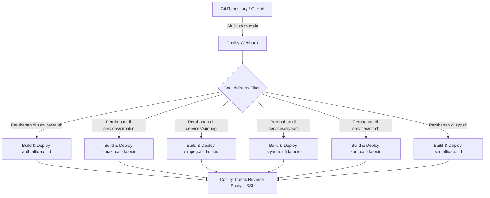

# Panduan Deployment SIM-Alfida di Coolify via Git Repository & Webhook

Dokumen ini adalah panduan langkah-demi-langkah resmi untuk mendeploy seluruh layanan SIM-Alfida pada server Coolify (VPS 2 vCPU, 8 GB RAM, 100 GB Storage) menggunakan koneksi langsung ke repositori Git dan pemicu otomatisasi Webhook.

---

## Ringkasan Alur Kerja

Metode ini menghubungkan Coolify langsung ke repositori Git project SIM-Alfida:
1. Coolify mendengarkan *push event* dari Git melalui Webhook.
2. Setiap kali ada commit baru di branch `main`, Coolify memeriksa direktori berkas yang berubah (*Watch Paths*).
3. Hanya layanan yang mengalami perubahan kode yang akan di-build dan di-deploy ulang.
4. Traefik (reverse proxy bawaan Coolify) secara otomatis memperbarui routing kontainer dan menerbitkan sertifikat SSL Let's Encrypt untuk setiap subdomain `*.alfida.or.id`.



---

## 1. Persiapan Database PostgreSQL Terpusat di Coolify

Untuk menghemat RAM VPS (8 GB), seluruh layanan berbagi **1 instance service PostgreSQL** yang sudah aktif di Coolify, dengan database terisolasi untuk masing-masing modul.

### Langkah Eksekusi:
1. Buka dasbor Coolify -> pilih Resource **PostgreSQL** yang sudah ada.
2. Buka menu **Terminal** atau akses PostgreSQL via GUI/CLI (pasm / DBeaver / psql).
3. Jalankan perintah SQL berikut:

```sql
CREATE DATABASE alfida_auth;
CREATE DATABASE alfida_simakin;
CREATE DATABASE alfida_simpeg;
CREATE DATABASE alfida_siyaum;
CREATE DATABASE alfida_spmb;
-- Database legacy simalfida biasanya sudah ada dari instalasi awal
```

> [!TIP]
> Catat kredensial PostgreSQL internal Coolify:
> - Format koneksi Docker Network internal: `postgresql://postgres:<password>@<coolify-db-container-name>:5432/<dbname>?schema=public`
> - Format IP internal / host: `postgresql://postgres:<password>@172.17.0.1:5432/<dbname>?schema=public`

---

## 2. Menghubungkan Repositori Git & Webhook di Coolify

### Langkah Menghubungkan Sumber Repositori:
1. Di Coolify, buka **Sources** -> Tambahkan atau pilih akun Git (GitHub / GitLab / Git Self-Hosted).
2. Jika menggunakan **GitHub App** bawaan Coolify:
   - Berikan izin akses ke repositori `simalfida`.
   - Coolify akan otomatis mengelola Webhook tanpa pengaturan token manual.
3. Jika menggunakan **Private Deploy Key / Custom Git**:
   - Salin Public Key yang diberikan Coolify ke GitHub (Settings -> Deploy Keys).
   - Di dasbor Coolify Application, buka tab **Webhooks**.
   - Salin **Manual Webhook Deployment URL**.
   - Masuk ke GitHub Repository -> **Settings** -> **Webhooks** -> **Add webhook**:
     - **Payload URL**: Tempel Webhook URL dari Coolify.
     - **Content type**: `application/json`.
     - **Secret**: Masukkan secret yang sesuai jika diatur di Coolify.
     - **Which events**: Pilih *Just the push event*.
     - Klik **Add webhook**.

---

## 3. Konfigurasi 5 Microservices + 1 Monolith di Coolify

Di dalam Project / Environment Coolify yang sama, klik **+ New** -> **Application** -> Pilih **Public/Private Git Repository** -> Pilih repositori `simalfida` dan branch `main`.

Ulangi pembuatan Application sebanyak 5 kali untuk microservices (dan 1 kali untuk modul monolith). Atur konfigurasi spesifik untuk masing-masing layanan pada tabel di bawah ini:

### Tabel Konfigurasi Aplikasi:

| Nama Layanan | FQDN (Domain) | Build Pack | Base Directory | Dockerfile Location | Port | Watch Paths (Wajib Diisi) |
|---|---|---|---|---|---|---|
| **alfida-auth** | `https://auth.alfida.or.id` | Dockerfile | `/` | `/services/auth/Dockerfile` | `3000` | `services/auth/**`<br>`packages/contracts/**`<br>`packages/auth-sdk/**`<br>`packages/ui/**`<br>`pnpm-lock.yaml` |
| **alfida-simakin** | `https://simakin.alfida.or.id` | Dockerfile | `/` | `/services/simakin/Dockerfile` | `3000` | `services/simakin/**`<br>`packages/contracts/**`<br>`packages/auth-sdk/**`<br>`packages/ui/**`<br>`pnpm-lock.yaml` |
| **alfida-simpeg** | `https://simpeg.alfida.or.id` | Dockerfile | `/` | `/services/simpeg/Dockerfile` | `3000` | `services/simpeg/**`<br>`packages/contracts/**`<br>`packages/auth-sdk/**`<br>`packages/ui/**`<br>`pnpm-lock.yaml` |
| **alfida-siyaum** | `https://siyaum.alfida.or.id` | Dockerfile | `/` | `/services/siyaum/Dockerfile` | `3000` | `services/siyaum/**`<br>`packages/contracts/**`<br>`packages/auth-sdk/**`<br>`packages/ui/**`<br>`pnpm-lock.yaml` |
| **alfida-spmb** | `https://spmb.alfida.or.id` | Dockerfile | `/` | `/services/spmb/Dockerfile` | `3000` | `services/spmb/**`<br>`packages/contracts/**`<br>`packages/auth-sdk/**`<br>`packages/ui/**`<br>`pnpm-lock.yaml` |
| **alfida-monolith** | `https://sim.alfida.or.id` | Dockerfile | `/` | `/Dockerfile` | `3000` | `apps/**`<br>`packages/database/**`<br>`packages/shared/**`<br>`pnpm-lock.yaml` |

> [!IMPORTANT]
> **Mengapa Base Directory harus `/` (Root Monorepo)?**
> Seluruh microservice di `services/*` bergantung pada paket bersama di `packages/*` (`@alfida/contracts`, `@alfida/auth-sdk`, `@alfida/ui`) dan `pnpm-lock.yaml` di root. Jika Base Directory disetel ke subfolder, proses pnpm install dan build akan gagal menemukan dependencies.

> [!WARNING]
> **Mengapa Watch Paths Sangat Kritis?**
> Karena ada 6 aplikasi yang membaca 1 repositori yang sama, tanpa Watch Paths, setiap kali ada `git push`, Coolify akan memicu build 6 aplikasi sekaligus secara bersamaan. Hal ini akan membuat CPU mencapai 100% dan VPS kehabisan memori (OOM). Dengan mengisi **Watch Paths**, Coolify hanya akan mem-build aplikasi yang berkas kodenya benar-benar dimodifikasi pada commit tersebut.

---

## 4. Templat Environment Variables per Layanan

Buka menu **Environment Variables** pada masing-masing Application di dasbor Coolify, lalu salin templat konfigurasi di bawah ini:

### A. alfida-auth (`https://auth.alfida.or.id`)
```env
NODE_ENV=production
PORT=3000
DATABASE_URL=postgresql://postgres:<password>@<db-container-name>:5432/alfida_auth?schema=public
AUTH_SECRET=<generate-via-openssl-rand-hex-32>
BETTER_AUTH_SECRET=<generate-via-openssl-rand-hex-32>
JWT_SECRET=<generate-via-openssl-rand-hex-32>
COOKIE_DOMAIN=.alfida.or.id
INTERNAL_API_URL=http://127.0.0.1:3001
NEXT_PUBLIC_APP_URL=https://auth.alfida.or.id
BETTER_AUTH_URL=https://auth.alfida.or.id

# Cloudinary untuk Avatar Pengguna
NEXT_PUBLIC_CLOUDINARY_CLOUD_NAME=<your-cloud-name>
NEXT_PUBLIC_CLOUDINARY_UPLOAD_PRESET=<your-preset>
```

### B. alfida-simakin (`https://simakin.alfida.or.id`)
```env
NODE_ENV=production
PORT=3000
DATABASE_URL=postgresql://postgres:<password>@<db-container-name>:5432/alfida_simakin?schema=public
AUTH_SECRET=<generate-via-openssl-rand-hex-32>
BETTER_AUTH_SECRET=<generate-via-openssl-rand-hex-32>
JWT_SECRET=<generate-via-openssl-rand-hex-32>
COOKIE_DOMAIN=.alfida.or.id
INTERNAL_API_URL=http://127.0.0.1:3001
NEXT_PUBLIC_APP_URL=https://simakin.alfida.or.id
NEXT_PUBLIC_AUTH_URL=https://auth.alfida.or.id

# MinIO S3 Storage untuk Dokumen Bukti Eviden (PDF)
S3_ENDPOINT=<s3-endpoint-host>
S3_PORT=443
S3_USE_SSL=true
S3_ACCESS_KEY=<your-s3-access-key>
S3_SECRET_KEY=<your-s3-secret-key>
S3_BUCKET=alfida-simakin

# Cloudinary untuk Foto Bukti Kegiatan
CLOUDINARY_CLOUD_NAME=<your-cloud-name>
CLOUDINARY_API_KEY=<your-api-key>
CLOUDINARY_API_SECRET=<your-api-secret>
NEXT_PUBLIC_CLOUDINARY_CLOUD_NAME=<your-cloud-name>
NEXT_PUBLIC_CLOUDINARY_UPLOAD_PRESET=<your-preset>
```

### C. alfida-simpeg (`https://simpeg.alfida.or.id`)
```env
NODE_ENV=production
PORT=3000
DATABASE_URL=postgresql://postgres:<password>@<db-container-name>:5432/alfida_simpeg?schema=public
AUTH_SECRET=<generate-via-openssl-rand-hex-32>
BETTER_AUTH_SECRET=<generate-via-openssl-rand-hex-32>
JWT_SECRET=<generate-via-openssl-rand-hex-32>
COOKIE_DOMAIN=.alfida.or.id
INTERNAL_API_URL=http://127.0.0.1:3001
NEXT_PUBLIC_APP_URL=https://simpeg.alfida.or.id
NEXT_PUBLIC_AUTH_URL=https://auth.alfida.or.id

# MinIO S3 Storage untuk berkas SK & foto pegawai
S3_ENDPOINT=<s3-endpoint-host>
S3_PORT=443
S3_USE_SSL=true
S3_ACCESS_KEY=<your-s3-access-key>
S3_SECRET_KEY=<your-s3-secret-key>
S3_BUCKET=alfida-simpeg
```

### D. alfida-siyaum (`https://siyaum.alfida.or.id`)
```env
NODE_ENV=production
PORT=3000
DATABASE_URL=postgresql://postgres:<password>@<db-container-name>:5432/alfida_siyaum?schema=public
AUTH_SECRET=<generate-via-openssl-rand-hex-32>
BETTER_AUTH_SECRET=<generate-via-openssl-rand-hex-32>
JWT_SECRET=<generate-via-openssl-rand-hex-32>
COOKIE_DOMAIN=.alfida.or.id
INTERNAL_API_URL=http://127.0.0.1:3001
NEXT_PUBLIC_APP_URL=https://siyaum.alfida.or.id
NEXT_PUBLIC_AUTH_URL=https://auth.alfida.or.id
```

### E. alfida-spmb (`https://spmb.alfida.or.id`)
```env
NODE_ENV=production
PORT=3000
DATABASE_URL=postgresql://postgres:<password>@<db-container-name>:5432/alfida_spmb?schema=public
AUTH_SECRET=<generate-via-openssl-rand-hex-32>
BETTER_AUTH_SECRET=<generate-via-openssl-rand-hex-32>
JWT_SECRET=<generate-via-openssl-rand-hex-32>
COOKIE_DOMAIN=.alfida.or.id
INTERNAL_API_URL=http://127.0.0.1:3001
NEXT_PUBLIC_APP_URL=https://spmb.alfida.or.id
NEXT_PUBLIC_AUTH_URL=https://auth.alfida.or.id

# Integrasi Handoff Siswa Baru ke SIAKAD
INTERNAL_SIAKAD_API_URL=http://<monolith-container-or-host>:3001
INTERNAL_SERVICE_SECRET=<generate-strong-random-secret>

# MinIO S3 Storage untuk unggah Akta, KK, Foto Calon Siswa
S3_ENDPOINT=<s3-endpoint-host>
S3_PORT=443
S3_USE_SSL=true
S3_ACCESS_KEY=<your-s3-access-key>
S3_SECRET_KEY=<your-s3-secret-key>
S3_BUCKET=alfida-spmb
```

### F. alfida-monolith (`https://sim.alfida.or.id`)
```env
NODE_ENV=production
PORT=3000
DATABASE_URL=postgresql://postgres:<password>@<db-container-name>:5432/simalfida?schema=public
AUTH_SECRET=<generate-via-openssl-rand-hex-32>
BETTER_AUTH_SECRET=<generate-via-openssl-rand-hex-32>
JWT_SECRET=<generate-via-openssl-rand-hex-32>
COOKIE_DOMAIN=.alfida.or.id
INTERNAL_SERVICE_SECRET=<generate-strong-random-secret>
NEXT_PUBLIC_APP_URL=https://sim.alfida.or.id
NEXT_PUBLIC_AUTH_URL=https://auth.alfida.or.id
```

---

## 5. Eksekusi Migrasi Skema Awal Prisma

Sebelum aplikasi pertama kali menerima traffic publik, pastikan tabel-tabel pada 5 database baru telah terbentuk.

### Pilihan A: Melalui Komputer Lokal / CI Runner (Paling Mudah)
Jalankan perintah ini dari repositori lokal dengan menyambungkan `DATABASE_URL` ke host PostgreSQL Coolify:

```bash
# Migrasi Database Auth
DATABASE_URL="postgresql://postgres:<pwd>@<coolify-ip>:5432/alfida_auth?schema=public" \
pnpm --filter @alfida/auth-api exec prisma db push

# Migrasi Database SIMAKIN
DATABASE_URL="postgresql://postgres:<pwd>@<coolify-ip>:5432/alfida_simakin?schema=public" \
pnpm --filter @alfida/simakin-api exec prisma db push

# Migrasi Database SIMPEG
DATABASE_URL="postgresql://postgres:<pwd>@<coolify-ip>:5432/alfida_simpeg?schema=public" \
pnpm --filter simpeg-api exec prisma db push

# Migrasi Database SIYAUM
DATABASE_URL="postgresql://postgres:<pwd>@<coolify-ip>:5432/alfida_siyaum?schema=public" \
pnpm --filter siyaum-api exec prisma db push

# Migrasi Database SPMB
DATABASE_URL="postgresql://postgres:<pwd>@<coolify-ip>:5432/alfida_spmb?schema=public" \
pnpm --filter @alfida/spmb-api exec prisma db push
```

### Pilihan B: Sinkronisasi Akun Legacy ke Auth Terpusat
Untuk menyalin seluruh user, guru, dan pegawai yang sudah ada di database legacy `simalfida` ke dalam SSO `alfida_auth`:

```bash
LEGACY_DATABASE_URL="postgresql://postgres:<pwd>@<coolify-ip>:5432/simalfida?schema=public" \
DATABASE_URL="postgresql://postgres:<pwd>@<coolify-ip>:5432/alfida_auth?schema=public" \
pnpm --filter @alfida/auth-api run migrate:legacy
```

---

## 6. Manajemen Beban Sumber Daya (2 vCPU & 8 GB RAM)

Agar VPS tetap stabil dan tidak mengalami lonjakan memori (Out Of Memory / OOM), terapkan rekomendasi batas memori (*Resource Limits*) pada setiap Application di Coolify (menu **Resource Limits**):

| Komponen / Layanan | Batas Memori (RAM Limit) | CPU Limit | Estimasi Idle / Running |
|---|---|---|---|
| PostgreSQL Terpusat | 1536 MB | 1.0 vCPU | ~300 - 600 MB |
| alfida-auth | 600 MB | 0.5 vCPU | ~180 - 250 MB |
| alfida-simakin | 600 MB | 0.5 vCPU | ~180 - 250 MB |
| alfida-simpeg | 700 MB | 0.5 vCPU | ~200 - 300 MB |
| alfida-siyaum | 600 MB | 0.5 vCPU | ~180 - 250 MB |
| alfida-spmb | 700 MB | 0.5 vCPU | ~200 - 300 MB |
| alfida-monolith | 1200 MB | 1.0 vCPU | ~400 - 600 MB |
| MinIO S3 Storage | 512 MB | 0.3 vCPU | ~100 - 200 MB |
| Traefik Coolify | 256 MB | 0.2 vCPU | ~50 - 100 MB |
| **Total Estimasi** | **~6400 MB** | - | **Aman dalam batas 8 GB RAM** |

> [!TIP]
> **Aktifkan Linux Swap di VPS Host:**
> Pastikan VPS Coolify Anda memiliki setidaknya **4 GB Swap File** untuk mengantisipasi lonjakan beban saat Docker build berlangsung:
> ```bash
> # Cek swap di VPS host
> swapon --show
> # Jika belum ada, buat 4 GB swap:
> sudo fallocate -l 4G /swapfile
> sudo chmod 600 /swapfile
> sudo mkswap /swapfile
> sudo swapon /swapfile
> echo '/swapfile none swap sw 0 0' | sudo tee -a /etc/fstab
> ```

---

## 7. Verifikasi dan Pengujian Deployment

1. **Deploy Manual Perdana**:
   - Klik tombol **Deploy** secara berurutan dimulai dari `alfida-auth`, kemudian `alfida-spmb`, `alfida-simpeg`, `alfida-simakin`, `alfida-siyaum`, dan `alfida-monolith`.
   - Hindari mengklik deploy semua aplikasi secara bersamaan pada *first run* agar proses unduh layer Docker dasar Node 22 Alpine berjalan bergantian.
2. **Cek Log Kontainer**:
   - Masuk ke tab **Logs** di masing-masing Application.
   - Pastikan muncul pesan:
     ```text
     Memulai SPMB API (NestJS) pada port 3001...
     Memulai SPMB Web (Next.js) pada port 3000...
       ▲ Next.js 15.x
       - Local: http://localhost:3000
       - Network: http://0.0.0.0:3000
     ```
3. **Uji Otomatisasi Webhook Git Push**:
   - Lakukan commit kecil di repositori pada branch `main` (misal update teks kecil di `services/spmb`).
   - Push commit ke GitHub.
   - Buka Coolify dashboard: pastikan hanya `alfida-spmb` yang statusnya berubah menjadi *Building / Deploying*, sedangkan layanan lain tetap berstatus *Running*.
4. **Verifikasi Domain & SSL**:
   - Buka browser dan kunjungi:
     - `https://auth.alfida.or.id`
     - `https://spmb.alfida.or.id`
     - `https://simpeg.alfida.or.id`
     - `https://simakin.alfida.or.id`
     - `https://siyaum.alfida.or.id`
     - `https://sim.alfida.or.id`
   - Pastikan gembok hijau SSL Let's Encrypt aktif dan tampilan antarmuka muncul dengan benar.
